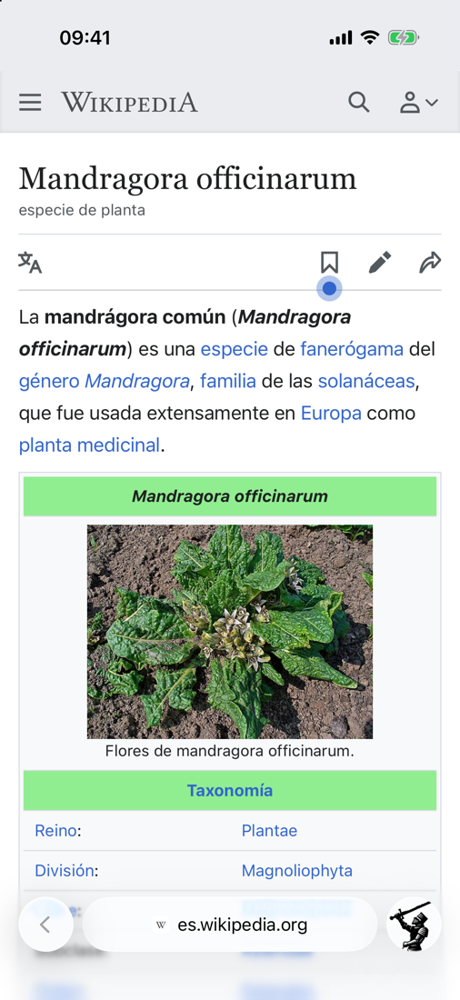
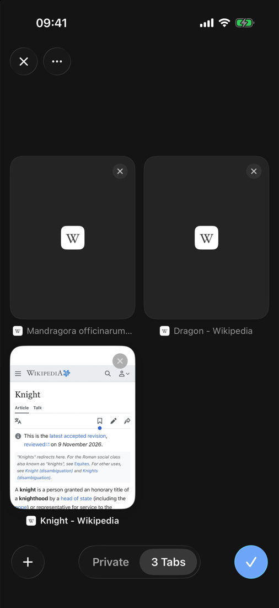
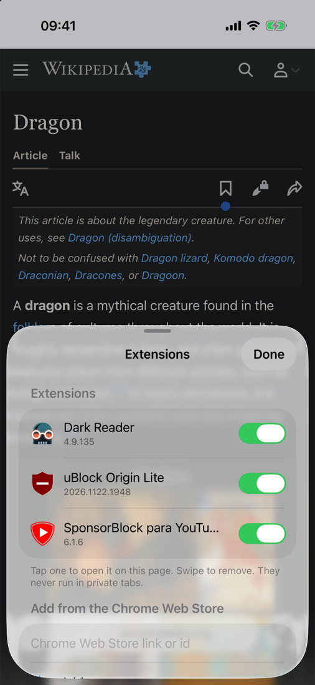
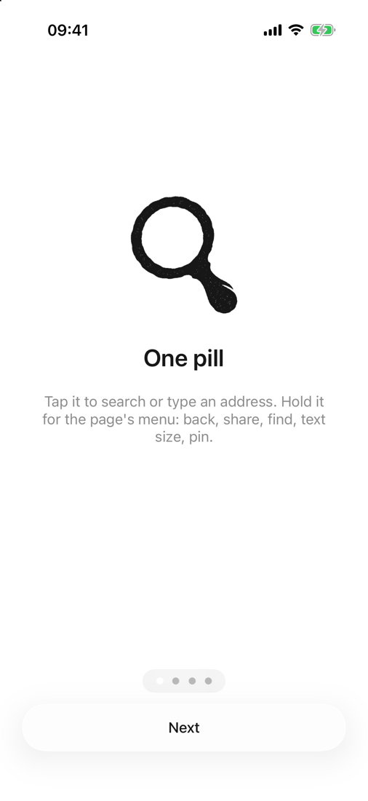

<p align="center"></p>

<h1 align="center">Mandragora Browser</h1>

<p align="center">A small, quiet iPhone browser that runs Chrome extensions, refuses cookie banners and fills in forms for you.</p>

<p align="center">
  
  
  
  
</p>

Mandragora is a fork of [Search for iPhone](https://github.com/driceroland/Search-iOS) by Office Commun. The one-pill design, the gestures, the ad blocking and the private tabs are theirs. What follows is what this one adds. It is a personal project, not affiliated with Office Commun, Google or Anthropic, and it isn't on the App Store.

## What it adds

- **Chrome extensions.** Open the Chrome Web Store, tap *Add to Search*, and the extension runs. Its signature is checked first, and it tells you what it will be able to do. They never run in private tabs.
- **Side panels.** Extensions that live in Chrome's side panel get a sheet over the lower half of the page, with the page still yours above it.
- **No cookie banners.** They are answered *reject* by themselves, wherever a site offers it.
- **An assistant that fills forms.** Save your details once, and it fills a page's fields with Claude. You bring your own API key. The key and your details stay in the Keychain; only the names of fields and details are sent, never their values, and it never submits a form.
- **Tabs by the thumb.** Few tabs sit at the bottom; *Private* and *Tabs* are one switch, and a tick takes you back to the page.
- **Its own look.** A darker dark, and woodcut drawings throughout.

## Gestures

| | |
|---|---|
| Tap the pill | Search, or type an address |
| Slide it sideways | Go from tab to tab |
| Slide it up | See every tab |
| Hold it | The page's menu |
| Tap the knight | Fill this page |
| Hold the knight | Extensions |

## How extensions run on iOS

WebKit has an extension engine, but iOS starts no service worker for an app like this one, and Chrome extensions are built around them. So when one is added its background is made a page, and a script that fills in the Chrome APIs WebKit lacks goes ahead of it. That script comes from [Search for Mac](https://github.com/driceroland/Search) and is adapted here.

It works with a good many extensions and not with all of them. Anything that needs a thing iOS doesn't have, such as native apps, the bookmarks API or screen capture, won't.

## Building

1. Open `Search.xcodeproj` in Xcode 26 or later.
2. Make a `Signing.local.xcconfig` next to it with your own team and bundle id:
   ```
   DEVELOPMENT_TEAM = ABCDE12345
   PRODUCT_BUNDLE_IDENTIFIER = com.you.mandragora
   ```
3. Run the `Search` scheme. iOS 18 or later; extensions need iOS 18.4.

The drawings are made from `Icon/art` by `Icon/art.swift`.

## License

[MIT](LICENSE). © 2026 Office Commun for the original, and its contributors. Changes © 2026 Sergio.
